 

<picture>
  <source media="(prefers-color-scheme: dark)" srcset="assets/baslik-koyu.svg">
  
</picture>

 
 

Büyük dil modelleriyle çalışan ürünler geliştiriyorum.

Python &nbsp;·&nbsp; FastAPI &nbsp;·&nbsp; PostgreSQL &nbsp;·&nbsp; Qdrant &nbsp;·&nbsp; Docker

 

[E-posta](mailto:goktugsw@gmail.com) &nbsp;·&nbsp; [LinkedIn](https://www.linkedin.com/in/g%C3%B6ktu%C4%9F-o%C4%9Fuzhan-topal-774016251/)

 

<picture>
  <source media="(prefers-color-scheme: dark)" srcset="assets/cizgi-koyu.svg">
  
</picture>

 

